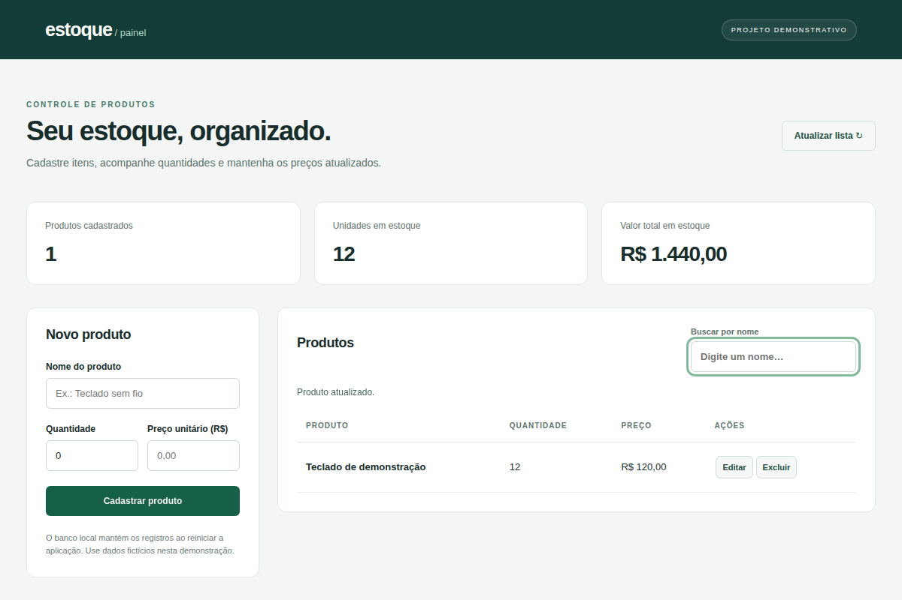

# Controle de estoque



Projeto de estudo e portfólio com painel web e API REST em Java 17 / Spring Boot. Permite cadastrar produtos, buscar por nome, editar preços e quantidades e excluir itens após confirmação.

O painel também calcula o número de produtos, as unidades disponíveis e o valor total do estoque. A interface usa HTML, CSS e JavaScript, sem framework frontend.

## Executar

Requisitos: JDK 17 e acesso à internet no primeiro uso do Maven Wrapper.

```bash
./mvnw spring-boot:run
```

No Windows: `mvnw.cmd spring-boot:run`.

Abra **http://localhost:8080**. Cadastre produtos fictícios pelo formulário. Ao reiniciar, os dados continuam no banco H2 em `dados/estoque.mv.db`. Essa pasta não é versionada: faça backup se quiser conservar sua demonstração.

## API

| Método | Caminho | Ação |
|---|---|---|
| GET | `/itens` | Listar; aceita `?nome=teclado` |
| GET | `/itens/{id}` | Consultar um produto |
| POST | `/itens` | Cadastrar |
| PUT | `/itens/{id}` | Editar o produto |
| PATCH | `/itens/{id}/quantidade` | Atualizar apenas a quantidade |
| DELETE | `/itens/{id}` | Excluir |

Exemplo de cadastro:

```json
{"nome":"Teclado sem fio","quantidade":10,"preco":120.00}
```

O servidor valida nome, quantidade e preço. Valores negativos e JSON inválido retornam erro; IDs inexistentes retornam 404. Há separação entre o controlador, os dados de entrada/saída e o armazenamento, com consultas SQL parametrizadas.

## Perfis

- `persistente` (padrão): JDBC + H2 em arquivo.
- `memoria`: implementação em memória para os testes da API.
- `demo`: implementação em memória com um teclado de exemplo.

```bash
./mvnw spring-boot:run -Dspring-boot.run.profiles=demo
./mvnw test
```

Os testes cobrem cadastro, consulta, filtros, edição, exclusão, validações e a leitura por uma nova instância do repositório JDBC. A verificação de reinício completo com banco em arquivo está no fluxo de integração contínua.

## Limites da demonstração

Este é um painel local de estudo. Não possui login, controle de permissões, histórico de movimentações ou tratamento de edição simultânea por vários usuários. Não publique a aplicação na internet para armazenar dados reais sem implementar esses recursos. H2 em arquivo precisa de disco persistente no ambiente de execução.

## Para apresentar

1. Cadastre três produtos fictícios.
2. Mostre os indicadores e filtre pelo nome.
3. Edite a quantidade de um produto.
4. Reinicie a aplicação para demonstrar a persistência.
5. Mostre o diálogo de exclusão e as validações da API.

Desenvolvido por Samir Gedeon como projeto de portfólio.
